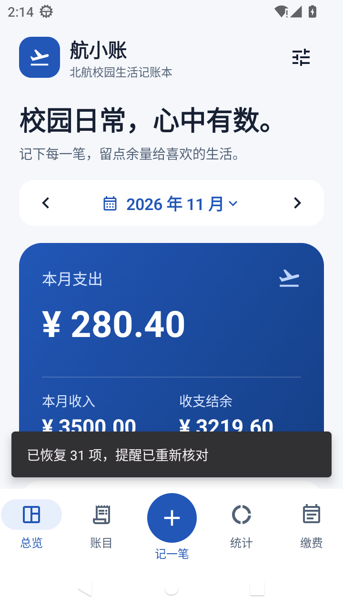
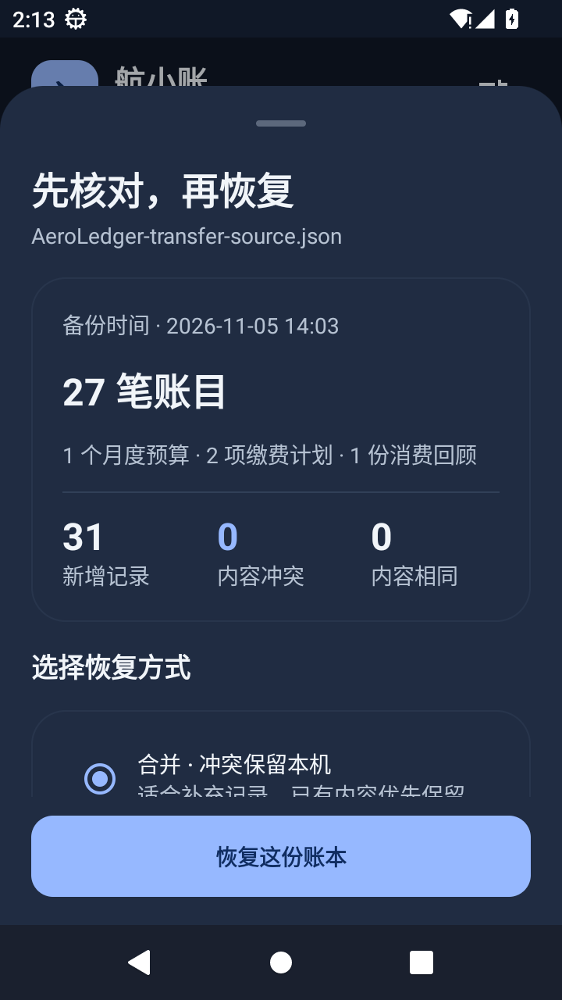

# AeroLedger

**航小账 · 北航校园生活记账本**。基于 Kotlin、Jetpack Compose Material 3、Room 与 MVVM 的原生 Android 应用，支持离线使用。

本仓库同时提供**可以直接安装的 APK**和**完整可构建的应用源码**，便于团队成员体验与二次开发。所有上传文件与目录均使用英文名称。

## Download

[Download AeroLedger-v1.1.apk](https://github.com/Ouniverse-X/AeroLedger/raw/refs/heads/main/releases/AeroLedger-v1.1.apk)

最低支持 **Android 8.0 / API 26**。成员把 APK 传到手机安装即可使用，无需 Android Studio、开发环境或账号。安装时按系统提示允许当前来源安装应用；缴费提醒需在各自手机允许系统通知。

每个人的数据保存在自己的手机，当前不提供跨设备同步或共享账本。默认下载为兼容 v1.0 的课程版，可直接覆盖原课程版安装。另提供[固定签名版](releases/AeroLedger-v1.1-stable.apk)，不同签名之间请按 [RELEASE.md](RELEASE.md) 通过完整备份迁移；校验值见 [SHA256SUMS](releases/SHA256SUMS)。

## Screenshots

| 总览 | 完整备份恢复（深色） |
| --- | --- |
|  |  |

## Features

| Module | Features |
| --- | --- |
| 收支记录 | 支出与收入增删改、金额校验、连续记账、常用模板、删除撤销及持久草稿 |
| 月度预算 | 独立月份预算、支出与剩余、用完与超支状态，账目变化自动重算 |
| 历史汇总 | 按日 / 月查看、备注搜索、类型与类别筛选、SQL 汇总与数据库分页 |
| 数据可视化 | 交互式分类环形图、金额与占比、近六个月收支趋势与明细联动 |
| 缴费提醒 | 计划管理、待缴 / 已缴 / 取消、单项开关、真实通知与撤销、重启恢复 |
| CSV | 文件预览、错误与重复提示、预览恢复、确认导入、全部或筛选导出 |
| 完整备份 | 账目、预算、计划、回顾、导入记录与主题；完整性校验、恢复预览及三种冲突策略 |
| 消费回顾 | 基于本地真实统计生成、查看依据、编辑保存、统计变化提示与重新生成 |
| 文本辅助录入 | 金额和日期提取、校园关键词分类、原文与规则依据、人工核对后入账 |
| 界面与适配 | 浅色 / 深色 / 系统主题、底部快捷入口、横屏侧边导航与双栏总览 |

金额以整数分保存，单笔与预算范围为 0.01～999999.99 元。收入不抵扣预算支出。**缴费计划不自动生成账目**，实际支出需要确认保存。

## Quick Start

```bash
git clone https://github.com/Ouniverse-X/AeroLedger.git
cd AeroLedger
```

用 Android Studio 打开项目根目录，选择 JDK 17，安装 SDK Platform 35 与 Build Tools 35.0.0，等待 Gradle Sync 完成后运行 `app`。

命令行也可构建：

```bash
# Configure sdk.dir in local.properties, or set ANDROID_HOME.
./gradlew :app:assembleDebug
./gradlew :app:assembleDemo
```

Windows 使用 `gradlew.bat`。生成的安装包位于 `app/build/outputs/apk/`。详细环境、测试与修改方式见 [DEVELOPMENT.md](DEVELOPMENT.md)。正式签名构建见 [RELEASE.md](RELEASE.md)。

## Development

- [DEVELOPMENT.md](DEVELOPMENT.md)：开发环境、运行、打包、签名与测试。
- [ARCHITECTURE.md](ARCHITECTURE.md)：模块职责、数据模型、统计与提醒流程。
- [REFERENCES.md](REFERENCES.md)：参考项目、固定提交与许可证说明。

```text
app/src/main/          Application source and Android resources
app/src/androidTest/  Room, notification and UI tests
app/schemas/          Versioned Room database schema
scripts/              Build and test entry points
tests/                JVM business-rule tests
gradle/wrapper/       Gradle Wrapper and distribution checksum
releases/             Classroom and fixed-signature APKs, checksums
.github/workflows/    APK build, lint and signed release
```

已验证：48 项 JVM 规则断言通过，API 26 / 33 / 35 模拟器各 12 项设备测试通过；debug 与固定签名 release 的 lint 通过。另验证了 v1.0 → v1.1 升级、后台进程重建及草稿恢复。真实物理机和厂商节电策略尚未覆盖，见 [DEVICE_TESTING.md](DEVICE_TESTING.md)。

## Demo Data and Privacy

从右上角设置载入 20 笔虚构校园示例，当前月示例支出 205.40 元、收入 2500.00 元；未设预算时添加 1500.00 元预算。每笔示例均有标注，不代表校园真实价格或实时支付记录。

应用不申请网络权限，不读取银行、支付账户、短信或其他应用通知。文本提取与消费回顾使用本地规则，无模型调用和费用。CSV 使用系统文件选择器授权，仅包含账目；换机或卸载前请在设置中导出完整备份，一并保留预算、缴费计划与回顾。备份文件含个人内容，需自行妥善保存；它不包含未保存草稿。

## Optional Browser Preview

后续以 APK 真机体验为默认方式，自动检查不会启动模拟器。以下仅为保留的可选开发工具，需使用时主动启动设备：

```bash
./scripts/start-preview.sh
```

打开 http://127.0.0.1:18880 ，可实时点击、拖动、滚动和输入中文。远程环境转发 18880 端口。预览为真实安卓画面，操作保存在选定设备；细节见 [PREVIEW.md](PREVIEW.md)。

## Backup and Validation

- [BACKUP_FORMAT.md](BACKUP_FORMAT.md)：完整备份、冲突策略和文件约定。
- [DEVICE_TESTING.md](DEVICE_TESTING.md)：设备矩阵、升级、草稿和真机验证方法。
- [CHANGELOG.md](CHANGELOG.md)：版本变化。
